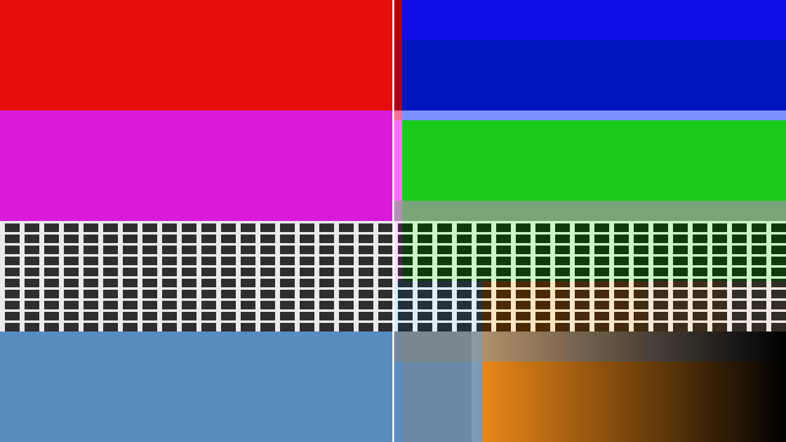

# Macroblock — chroma subsampling for Resolume and OpenFX

> **AI-assisted project.** This codebase was created with [Claude](https://claude.com/claude-code)
> (Anthropic), directed and reviewed by a human author. What it does to a pixel
> is written out in [How it works](#how-it-works), and the claims it makes about
> itself are checked by an offline harness in this repo rather than just
> asserted. Try it in your browser before you install anything.

Every clip on your machine was encoded with the colour thrown away. H.264 and
HEVC sample chroma once per 2×2 block of pixels and keep every pixel's
brightness; DV sampled it once per four pixels across; a broadcast link does it
once per two. You've never seen it, because at that scale it's properly hard to
see.

Macroblock lets the grid be any size you like. It goes from the two-pixel pair a
codec uses, through blocks you can read from the back of a room, to a single
chroma value for the whole canvas, at which point the picture keeps every bit of
its detail and turns into a monochrome of its own average colour. Then it does
the same thing to luma on a second, independent grid, which no sampling format
has ever offered: a mosaic in brightness with every colour edge exactly where it
was.

In Resolume the grid follows the music.



<sub>Rendered by the plugin's own offline harness in a headless GL context, not a Resolume screen capture. These are frames through the shaders it ships with.</sub>

## Try it in your browser

**<https://macroblock-demo.stoatworks-labs.com>**

It isn't the plugin: it's the GLSL from `source/shaders/`, copied across unedited
and run in WebGL2 over clips generated in the page, with the parameters this
plugin's constructor declares and the conversions its own code applies. There's
nothing to install, and nothing you load leaves your machine.

Start on Colour bars with the 4:2:0 preset and Show Grid on. That's the format
almost everything you play is already in, applied a second time, and your first
reaction will probably be that it does very little. Then drag Chroma H.

It's a port, so it isn't evidence about the plugin: a browser isn't Resolume,
GLSL ES 3.00 isn't desktop GL 4.1 core, and nothing on that page measures
anything. The page says so itself. The numbers worth trusting are in
[Status](#status), and they come from the harness in this repo.

**Video:** [What it does, in 51 seconds](https://www.youtube.com/watch?v=Ie6mbVMu21k)

<!-- downloads:start -->

## Download

**[v0.1.4](https://github.com/stoatworks-labs/macroblock/releases/tag/v0.1.4)** — prebuilt for macOS, Windows and Linux. Pick your platform:

<details>
<summary><b>macOS</b> — Universal (Apple Silicon + Intel)</summary>

| Build | Download | Size |
| --- | --- | --- |
| Universal (Apple Silicon + Intel) · .dmg disk image | [`macroblock-0.1.4-macos-universal.dmg`](https://github.com/stoatworks-labs/macroblock/releases/download/v0.1.4/macroblock-0.1.4-macos-universal.dmg) | 211 KB |
| Universal (Apple Silicon + Intel) · .zip archive | [`macroblock-macos-universal.zip`](https://github.com/stoatworks-labs/macroblock/releases/latest/download/macroblock-macos-universal.zip) | 167 KB |
| Universal (Apple Silicon + Intel) · .zip archive (OpenFX — Resolve, Vegas, Nuke) | [`macroblock-ofx-macos-universal.zip`](https://github.com/stoatworks-labs/macroblock/releases/latest/download/macroblock-ofx-macos-universal.zip) | 233 KB |

</details>

<details>
<summary><b>Windows</b> — x64</summary>

| Build | Download | Size |
| --- | --- | --- |
| x64 · .exe installer | [`macroblock-0.1.4-windows-x86_64-setup.exe`](https://github.com/stoatworks-labs/macroblock/releases/download/v0.1.4/macroblock-0.1.4-windows-x86_64-setup.exe) | 219 KB |
| x64 · .zip archive | [`macroblock-windows-x86_64.zip`](https://github.com/stoatworks-labs/macroblock/releases/latest/download/macroblock-windows-x86_64.zip) | 112 KB |
| x64 · .zip archive (OpenFX — Resolve, Vegas, Nuke) | [`macroblock-ofx-windows-x86_64.zip`](https://github.com/stoatworks-labs/macroblock/releases/latest/download/macroblock-ofx-windows-x86_64.zip) | 67 KB |

</details>

<details>
<summary><b>Linux</b> — x64</summary>

| Build | Download | Size |
| --- | --- | --- |
| x64 · .zip archive (OpenFX — Resolve, Vegas, Nuke) | [`macroblock-ofx-linux-x86_64.zip`](https://github.com/stoatworks-labs/macroblock/releases/latest/download/macroblock-ofx-linux-x86_64.zip) | 707 KB |

</details>

All builds, checksums and release notes: [github.com/stoatworks-labs/macroblock/releases](https://github.com/stoatworks-labs/macroblock/releases).

macOS builds are signed and notarised and open normally. The Windows builds are unsigned, so SmartScreen warns once.

<!-- downloads:end -->

## What it does

### The chroma lattice

Two sliders, horizontal and vertical, linked by default so blocks are square.
Below 64 pixels they're absolute: a twelfth of the travel is a two-pixel block
at 720p, at 1080p and at 4K alike, which is what lets a preset call itself 4:2:0
with a straight face. Above 64 pixels they're relative to the canvas, so the end
of the travel is one chroma value for the whole frame whatever you're running
at.

Unlinking them matters: 4:2:2 and 4:1:1 subsample horizontally only, which is
why a broadcast link copes with a red caption and DV doesn't.

### The luma lattice

The same again, on its own grid, applied to brightness. No format does this, and
it doesn't look like a mosaic filter: colour edges stay exactly where they
were, so a face stays the right colour while its shape turns into blocks.

### How a block gets its value

- **Sampling** — Average is the box mean an encoder takes. Point keeps one pixel
  per block, which is what a cheap converter does and looks it: harder, noisier,
  obviously wrong.
- **Reconstruction** — Blocky holds one value flat across its block. Smooth
  interpolates between block sites, which is what a real decoder's upsampler
  does, and at large blocks it's a colour smear rather than a mosaic.
- **Siting** — where in its block a sample is considered to live. Centred is
  JPEG and MPEG-1, co-sited is MPEG-2 and most broadcast. It only shows under
  Smooth, which is why it's a dropdown and not a slider.
- **Matrix** — Rec. 709, 601, 2020 or YCoCg. It isn't cosmetic: it decides which
  colours survive being averaged. The Rec. matrices carry a blue and a red axis;
  YCoCg carries green and magenta, so a different pair of things collapses.
- **Average In** — Gamma is what every real encoder does, luminance error on
  saturated edges included. Linear light is the physically defensible one, and
  isn't video.
- **Block Steps** — Integer is a real sampling lattice. Free lets the size land
  between pixels, which sweeps smoothly instead of stepping. Powers of 2 is
  every broadcast format there is.

### The audio side (Resolume only)

Resolume hands a plugin a 64-bin spectrum once per frame. Macroblock splits it
into full-range, low, mid and high, follows each band with an envelope you can
set the attack and release of, and normalises it against that band's own recent
peak, which is what makes the same patch work on a quiet stem and a mastered
track.

Three rules for what that does to the grid:

- **Follow** — the block size tracks the band. Breathing.
- **Step** — an onset detector latches a new size on each hit and it decays
  until the next one. Blocks snap on the beat instead of wobbling.
- **Gate** — hard on above a threshold, off below.

Chroma and luma each get their own band and their own signed amount, so audio
can take the grid *down* as well as up. The amount is added to the control, not
multiplied by it, so the same setting means the same swing wherever the slider
is parked.

## How it works

Per frame, and only what is needed:

1. **Convert and reduce, horizontally.** Every source pixel is read exactly
   once, unpremultiplied, converted to Y'CbCr, and accumulated into one texel
   per block-column, weighted by its own alpha, so a transparent pixel
   contributes its area and not its colour.
2. **Reduce vertically**, over that buffer, into one texel per block.
3. **Composite.** The source at full resolution supplies whatever wasn't
   subsampled; the grids supply what was; the matrix is inverted, the result is
   clamped to 0..1, and alpha is put back.

Steps 1 and 2 run once for chroma and once for luma, unless the two grids are
identical, in which case one serves both. When neither grid is doing anything
the composite returns the host's own texel untouched, which is why "the effect
at zero is a no-op" is a bit-exact claim here rather than an approximate one.

**The separable reduction is why there's no quality control.** A one-pass
gather costs B² taps per output texel; separated, the frame's total is exactly
W×H taps at every block size. A two-pixel chroma block and a whole-canvas one
read the frame the same number of times, so there is nothing to trade.

## Status

Everything below is measured by `tools/verify.sh` on one machine rather than asserted:

| check | what it establishes |
|---|---|
| `--partition` | the lattice partitions the axis at 154 combinations of size and span, including non-integer sizes |
| `--matrix` | every matrix and its inverse are an identity to 1.2e-7 |
| `--mean` | a block's value is the box mean of that block, computed independently |
| `--cpu` | the GPU and the OpenFX renderer agree to 1.5e-3 across eleven configurations |
| `--identity` | at zero the output is **bit-identical** to the input, 0 of 230400 components differing |
| `--constant` | a flat colour survives every lattice and both reconstructions to 8e-5 |
| `--alpha` | alpha is untouched exactly, and the mean is alpha-weighted |
| `--full` | at the end stop every pixel carries one chroma value, and it is the frame's own mean |
| `--audio` | silence stays silent, the bands are separate, Step latches, Gate snaps, Sensitivity moves the threshold |
| `--presets` | every preset is alive and distinct, and the four format presets land on the right block size at 720p, 1080p, 1440p and 4K |
| `sweep.py` | all 24 controls change the picture |

The audio side has also been driven by real music: `tools/spectrum.py`
analyses an audio file and `mbtest --pipe --spectrum` feeds the result to the
plugin through the same call Resolume makes, so the analyser and the onset
detector have been exercised on real audio rather than on a synthetic click
train.

**Not yet verified:** it's never been run inside Resolume, or in any OpenFX
host. Nothing here knows what Resolume's 64 spectrum bins mean in hertz: the
bands are defined on bin *indices*, and the mapping is an assumption that only a
session in Arena can settle. The Windows build compiles but has never been run.
`AGENTS.md` has the full list.

## Building

```bash
git clone --recurse-submodules https://github.com/stoatworks-labs/macroblock
cd macroblock
cmake -B build -DCMAKE_BUILD_TYPE=Release
cmake --build build
cmake --install build        # into ~/Documents/Resolume Arena/Extra Effects
```

`cmake --build build` also makes `build/Macroblock.ofx.bundle`; copy it to
`/Library/OFX/Plugins` for Resolve, Nuke, Natron or Vegas. `-DBUILD_OFX=OFF`
skips it.

macOS needs no extra dependencies. Windows needs GLEW, which arrives through
`vcpkg.json`.

Run `tools/verify.sh` before believing any of it.

<!-- attributions:start -->
This project is built on other people's work — see [ATTRIBUTIONS.md](ATTRIBUTIONS.md).
<!-- attributions:end -->

## Licence

MIT. See [LICENSE](LICENSE) and [ATTRIBUTIONS.md](ATTRIBUTIONS.md).
